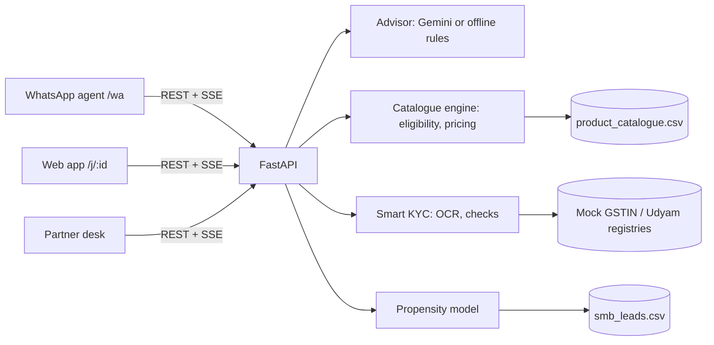

# Udyam One — Airtel SYNC 2026 · Track A (Project Udyam Digital)

A small business discovers the right bundle, gets a single transparent price, completes KYC from phone photos,
pays, and tracks activation, **on the web or on WhatsApp, in English, Hindi or Hinglish**. Both channels share one
live journey, so a customer can start on WhatsApp and finish on a laptop (or the reverse).

> "Accel Business" is the fictional operator from the case. All data is the synthetic challenge pack.

## Team Winter is Calling

- **Krrish Rastogi**: Udyam One (this app) and the Round 1 deck.
- **Om** ([OMGITCODE](https://github.com/OMGITCODE)): built **OneJourney**, our first prototype, kept in full in
  [`onejourney/`](onejourney/) with all 20 of his original commits in this repository's history
  (from [OMGITCODE/Airtel-Sync](https://github.com/OMGITCODE/Airtel-Sync)). Udyam One builds on ideas from it: the
  catalogue-grounded GenAI advisor, cohort analytics, delete-my-data, assumed-quantity disclosure, PII redaction before
  the LLM and the in-app privacy page.

Demo video: https://vimeo.com/1244895978

## Run it

Needs Python 3.11+, Node 18+ and the Tesseract OCR binary (`apt install tesseract-ocr` / `brew install tesseract`).

```bash
cp .env.example .env        # optional: add GEMINI_API_KEY
./run.sh                    # macOS/Linux: creates .venv, installs deps, builds the web app if needed
```

Windows (PowerShell): `copy .env.example .env`, then `powershell -ExecutionPolicy Bypass -File run.ps1`.
If Tesseract isn't detected, set `TESSERACT_CMD` in `.env`.

Check everything works (with the server running): `python scripts/smoke_test.py` should print 10/10 PASS.

Open **http://localhost:8000**.

| URL | What it is |
|---|---|
| `/` | Product landing page |
| `/start` or **Start in 3 minutes** | Web journey (laptop) |
| `/wa` | WhatsApp agent in a phone frame (open on a real phone on the same Wi-Fi: `http://<laptop-ip>:8000/wa`) |
| `/stage` | **Demo stage**: laptop + phone side by side, live-synced, with 1-click scripted scenarios |
| `/partner` | Partner desk: Market pulse (filterable cohort funnel), live hand-offs, propensity-ranked win-back list |
| `/privacy` | Plain-language privacy note (DPDP Act) |

Frontend dev mode with hot reload: `cd frontend && npm install && npm run dev` (http://localhost:5173, proxies `/api` to :8000).

## 3-minute demo script (use `/stage`)

1. **Dental clinic · English**: a WhatsApp voice note fills business, size and city in one go. The GSTIN is
   fetched from the registry. The plan appears on the phone *and* the laptop, CCTV is added on the web, and the
   price updates on both. Consent, 4 document photos (OCR plus 11 checks), UPI, then live order updates on WhatsApp.
2. **Kirana · Hinglish**: no GST, so WhatsApp Business API is locked and explained. "Sasta option dikhao" gives the
   Essential plan, then a hand-off with full context appears on `/partner`.
3. **Restaurant · हिन्दी**: a Hindi conversation, then KYC with applicant K01. The registry says **GSTIN CANCELLED**
   and the Udyam number is blank, so the journey is blocked and routed to a partner automatically.

Everything is also clickable by hand inside both screens. The mic works in Chrome/Edge. Elsewhere, sample voice
notes are offered.

## What's inside

- **Advisor** (`backend/advisor.py`): Gemini (`GEMINI_API_KEY`) extracts facts from any Indian language and
  answers questions. A deterministic English/Hindi/Hinglish engine runs when no key is set or a call fails.
  **The LLM never sets prices or eligibility.**
- **Catalogue engine** (`backend/engine.py`): eligibility (city tier, staff, sites, active GSTIN, product
  dependencies), term-based pricing (24-month = bottom of the catalogue range, minimum term = top), 18% GST shown
  separately, setup fees, install ETA, and add-on suggestions.
- **Smart KYC** (`backend/kyc.py`): Tesseract OCR with a blur gate (asks for a retake), automatic deskew, and a
  GSTIN checksum validator that corrects OCR lookalikes only when the checksum or registry confirms the
  correction, so tampered numbers still fail. Then registry lookups and cross-document checks (names, proprietor,
  address + PIN, bill ≤ 90 days old, ID validity).
  On the 12 specimen applicants it flags: K01 cancelled GSTIN + blank Udyam no., K02 tilted photo (fixed),
  K04 blurry photo, K05 no Udyam, K06 altered GSTIN, K07 certificate ≠ registry name, K11 bill 257 days old.
- **Propensity model** (`backend/propensity.py`): logistic regression on the 5,000 leads. Held-out AUC 0.73.
  The top 20% of scores capture 43% of activations (2.15× lift). It drives the partner win-back list and
  hand-off priority.
- **Privacy by design**: consent before any upload, masked IDs, identifiers redacted before any text reaches
  Gemini, and **Delete my data** (a button in Verify, or type `DELETE` on WhatsApp).
- **Honest plans**: assumed quantities are labelled ("Assumed one per team member (6)") until the owner adjusts
  them; locked products explain why (e.g. needs an active GSTIN).
- **Story-first demo**: a "Meet Sunita" before/after on the landing page, plus narrated chapter captions on `/stage`.
- **Live sync**: server-sent events per journey. Web and WhatsApp render the same message stream and state.



## Honest limits

Prototype only. Payments, installation and registry lookups are simulated. State is in memory (restart = reset).
There is no authentication. Uploaded document images stay in server memory only and are lost on restart.
WhatsApp is a faithful web simulation of the WhatsApp Business API flow, not a live WhatsApp number.
See `docs/privacy-note.md`.
